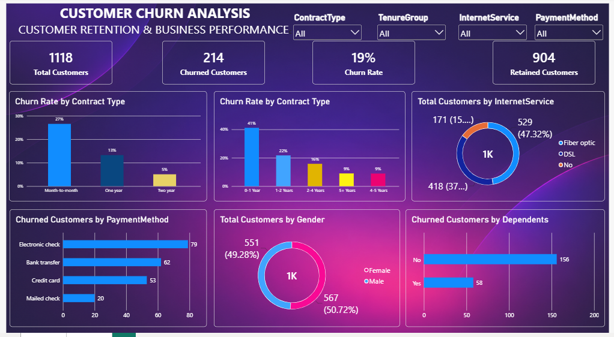

# Nexora Telecom — Customer Churn Analysis

An end-to-end data analytics case study for **Nexora Telecom**, a fictional telecommunications company. The project explores customer churn using Python (Pandas, NumPy, Matplotlib and Seaborn), SQL Server, and Power BI.

> **Project context:** Nexora Telecom is a fictional company created for this portfolio case study. This is an independent learning project and does not represent work performed for, or an affiliation with, a real company.

## Project objective

Act as a data analyst supporting Nexora Telecom's customer-retention team. Identify customer segments associated with higher churn, summarize the business risks visible in the sample dataset, and recommend practical retention actions that the fictional business could test.

## Dashboard preview



The interactive Power BI report is available in [`PowerBI/Customer_Churn_Dashboard.pbix`](PowerBI/Customer_Churn_Dashboard.pbix).

## Dataset

- **Records:** 1,200 customers
- **Columns:** 17
- **Churn encoding:** `1` = churned; `0` = retained
- **Missing values:** 0
- **Duplicate rows:** 0
- **Tenure groups:** 0–12, 13–24, 25–48, and 49–72 months

The cleaned sample dataset is available here: [customer_churn_cleaned_fixed.csv](Dataset/customer_churn_cleaned_fixed.csv). It is not verified production data from a real company. Findings are illustrative and should not be interpreted as actual Nexora Telecom business results.

## Tools and workflow

1. **[Python / Jupyter Notebook](Python/Customer_Churn_Analysis.ipynb)** — validate the cleaned data, calculate churn metrics, compare segments, and create exploratory visualizations.
2. **[SQL Server analysis](SQL/Customer_Churn_Analysis.sql)** — run grouped churn analyses and cross-segment queries against `customer_churn_db.dbo.customer_churn_cleaned`.
3. **Power BI** — present headline KPIs, segment comparisons, and slicers in an interactive report.

## Key findings

The following findings are calculated from the sample dataset used in this portfolio project:

- Overall churn is **19.08%** (229 of 1,200 customers); 971 customers are retained.
- Month-to-month contracts have the highest churn (**26.48%**), compared with **12.75%** for one-year and **5.31%** for two-year contracts.
- The first 12 months are the highest-risk tenure period: **41.36%** churn for customers in the 0–12 month group. Churn falls to **8.67%** in the 49–72 month group.
- Electronic-check customers have the highest churn among payment methods (**22.08%**); mailed-check customers have the lowest (**14.81%**).
- Customers with 3 or more support tickets have a **28.47%** churn rate, compared with **16.24%** among customers with no support tickets.
- Average tenure is **24.51 months** among churned customers and **39.12 months** among retained customers.

See [Business Impact Insights](Business_Impact_Insights.md) for interpretation, recommendations, limitations, and suggested business KPIs.

## Repository structure

```text
Customer-Churn-Analysis/
├── Dataset/
│   └── customer_churn_cleaned_fixed.csv
├── Python/
│   └── Customer_Churn_Analysis.ipynb
├── SQL/
│   └── Customer_Churn_Analysis.sql
├── PowerBI/
│   ├── Customer_Churn_Dashboard.pbix
│   └── README.md
├── Images/
│   ├── Dashboard image.PNG
│   └── README.md
├── Business_Impact_Insights.md
└── README.md
```

## How to run

### Python

1. Open the [Python analysis notebook](Python/Customer_Churn_Analysis.ipynb) in Jupyter Notebook, JupyterLab, or Google Colab.
2. Keep the CSV in the `Dataset` folder at the project root. The notebook also supports running from inside the `Python` folder and uploading the CSV to Colab.
3. Run the notebook from top to bottom.

Required packages: `pandas`, `numpy`, `matplotlib`, and `seaborn`.

### SQL Server

1. Import the [cleaned CSV dataset](Dataset/customer_churn_cleaned_fixed.csv) into SQL Server as `dbo.customer_churn_cleaned` in a database named `customer_churn_db` (or update the database/table reference in the script to match your setup).
2. Open the [SQL analysis script](SQL/Customer_Churn_Analysis.sql) in SQL Server Management Studio.
3. Confirm the database and table names, then run the queries. The script has 18 analysis queries and a final validation query.

### Power BI

The interactive dashboard was built in Power BI Desktop. Download the [Customer Churn Power BI dashboard](PowerBI/Customer_Churn_Dashboard.pbix) and open it in Power BI Desktop. If prompted, update the data source to the local project CSV or your SQL Server table and refresh the model.

## Important interpretation note

This project is descriptive analysis. Segment differences show associations in this sample dataset; they do not prove that a contract, payment method, support ticket, or customer characteristic causes churn. Revenue figures associated with churned records are not automatically recoverable revenue or proven financial loss. Retention recommendations should be tested and measured before claiming business impact.

## Author

Chandan Kumar Chauhan
